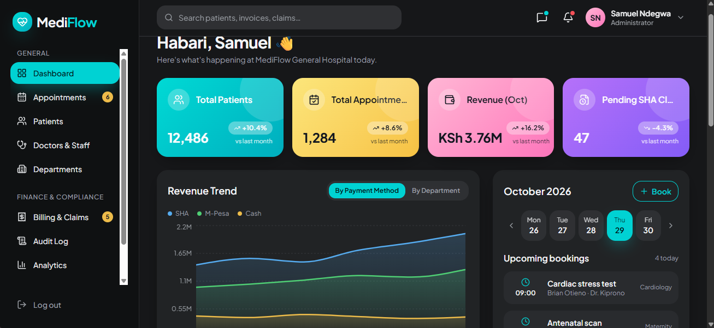
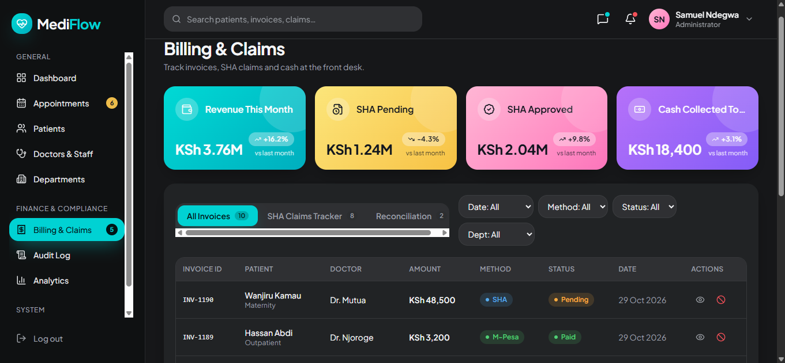
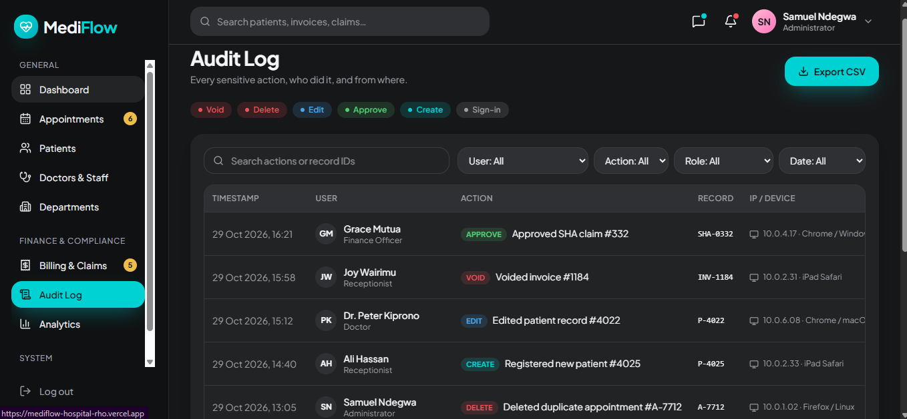
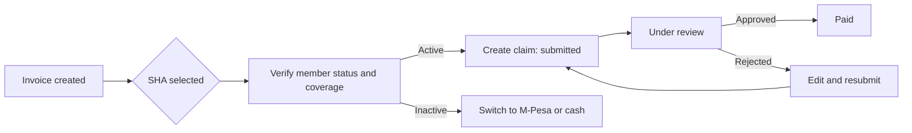
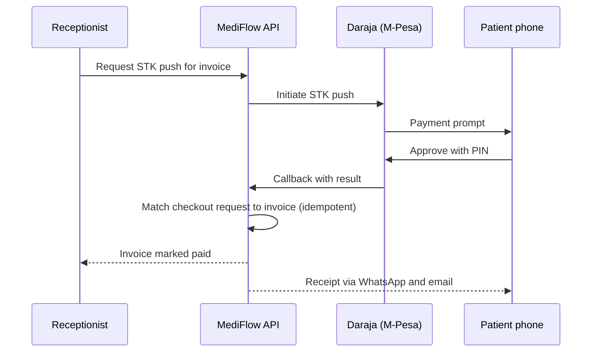
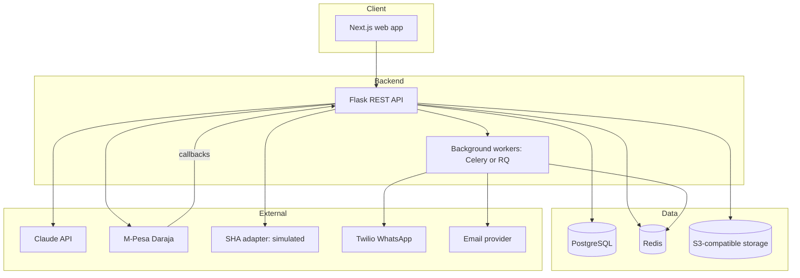

# MediFlow

Live Demo: https://mediflow-hospital-rho.vercel.app/

**A role-based hospital management and telehealth platform with multi-method billing (SHA, M-Pesa, cash), AI-assisted workflows, and a full audit trail.**


## Table of Contents

- [Overview](#overview)
- [Screenshots](#screenshots)
- [Key Features](#key-features)
- [User Roles](#user-roles)
- [Payment and Claims Flows](#payment-and-claims-flows)
- [AI Features](#ai-features)
- [Architecture](#architecture)
- [Tech Stack](#tech-stack)
- [Project Structure](#project-structure)
- [Getting Started](#getting-started)
- [Environment Variables](#environment-variables)
- [Demo Accounts](#demo-accounts)
- [API Overview](#api-overview)
- [Testing](#testing)
- [Security and Privacy](#security-and-privacy)
- [Deployment](#deployment)
- [Project Status and Roadmap](#project-status-and-roadmap)
- [Known Limitations](#known-limitations)
- [Contributing](#contributing)
- [License](#license)
- [Author](#author)

---

## Overview

Many hospitals still run on paper registers, spreadsheets, separate M-Pesa statements, and manual insurance follow-up. The result is fragmented patient data, lost or late insurance claims, weak cash controls, and no real-time view of revenue.

**MediFlow** replaces that with one system of record covering the full patient journey:

> Registration → Appointment → Consultation → Prescription → Billing → Follow-up → Reporting

It combines a staff-facing operations back office (billing, claims, audit, analytics) with a patient-facing portal, and adds AI features that reduce clinician and front-desk workload.

MediFlow is designed for the Kenyan hospital context, including **SHA (Social Health Authority)** claims, **M-Pesa** payments and **WhatsApp** communication, and is built to production-minded standards: role-based access enforced at the API, an append-only audit log, idempotent payment handling, and encrypted storage of sensitive data.

## Screenshots

> Replace these placeholders with real screenshots once the UI is built.

| Admin Dashboard | Doctor Dashboard |
|---|---|
|  |  |

| Billing and Claims | Audit Log |
|---|---|
|  |  |

## Key Features

**Patient and records**
- Patient registration with unique patient numbers, allergies, chronic conditions and SHA details
- Duplicate detection and fast search by name, patient number or phone
- Visit records, structured prescriptions, and encrypted lab report and scan uploads
- Chronological patient timeline

**Appointments and queue**
- Doctor availability templates with exceptions and conflict-free slot booking
- Walk-in registration, check-in, and a live per-doctor queue
- Reschedule and cancel rules, plus no-show risk flags

**Billing and claims**
- One unified Invoice / Transaction / Claim model for every payment method
- **SHA:** eligibility verification, claim lifecycle tracking, split billing (SHA plus patient co-pay), aging alerts, and resubmission of rejected claims
- **M-Pesa:** STK push, idempotent callback matching, and a reconciliation queue for unconfirmed payments
- **Cash:** manual entry with staff attribution, instant receipts, and daily reconciliation
- Admin-approved void and refund workflow (nothing is ever hard-deleted)

**Notifications**
- Central notification service for WhatsApp and email, with templates, retries, delivery logs, consent and opt-out handling

**Analytics**
- Admin: revenue by payment method, doctor, department and month; claims aging and approval rates
- Doctor: own monthly revenue, patients seen and average consultation time

**Security and compliance**
- JWT authentication with role-based access control enforced on every endpoint
- Append-only audit log covering record reads as well as edits
- Rate limiting, input validation, and encryption of sensitive fields

## User Roles

| Capability | Patient | Doctor | Receptionist | Admin |
|---|:-:|:-:|:-:|:-:|
| Self-register and book appointments | Yes | | | |
| Register and check in patients | | | Yes | Yes |
| View clinical notes and labs | Own | Patients they treat | | Read-only (logged) |
| Write notes and prescriptions | | Yes | | |
| Record payments and create invoices | Pay own | | Yes | Yes |
| Verify SHA and create claims | | View status | Yes | Full |
| Approve voids and refunds | | | Request | Approve |
| Revenue analytics | | Own only | Daily cash view | Full |
| Manage users, prices, departments | | | | Yes |
| View audit log | | | | Yes |

## Payment and Claims Flows

### SHA claim lifecycle



Claims that sit in a status longer than the configured thresholds are highlighted in the Claims Tracker and trigger staff alerts, so nothing is left without a follow-up owner.

### M-Pesa payment



If a callback never arrives, the transaction is marked **Unconfirmed** and appears in the reconciliation queue.

### Cash

The cashier enters the amount tendered, the system generates the invoice and receipt, calculates change, and records who took the payment. Totals feed the daily cash reconciliation view.

## AI Features

| Feature | What it does | Safeguard |
|---|---|---|
| Triage assistant | Suggests department and urgency from described symptoms | Never diagnoses; shows an emergency message for red-flag symptoms |
| Visit summaries | Condenses a doctor's raw notes into a clean summary | Doctor must review and approve before it is saved |
| No-show risk | Rule-based score from appointment history | Advisory flag only |
| Natural-language reports (planned) | Admin asks for a report in plain language | Model chooses from an allowlist of read-only, role-checked report functions; it never writes SQL |

AI design principles:
- **Assistive only.** AI never changes a clinical record on its own.
- **Data minimization.** Only the fields needed for a task are sent, with names, phone numbers and ID numbers masked.
- **Backend-only calls.** The API key never reaches the browser.
- **Graceful degradation.** Every workflow still works if the AI service is unavailable.
- **Logged and labeled.** AI interactions are logged and AI-generated content is marked in the UI.

## Architecture



All external services are wrapped in adapter modules with timeouts, retries and logging, so any provider can be swapped or mocked in tests.

## Tech Stack

| Layer | Technology |
|---|---|
| Frontend | Next.js, React, TypeScript, Tailwind CSS |
| Backend | Python, Flask, SQLAlchemy, Alembic |
| Database | PostgreSQL |
| Jobs and cache | Redis with Celery (or RQ) |
| File storage | S3-compatible object storage (private bucket, signed URLs) |
| AI | Anthropic Claude API (Python SDK) |
| Payments | M-Pesa Daraja API; SHA via adapter interface |
| Messaging | Twilio WhatsApp, Resend or SendGrid for email |
| CI/CD | GitHub Actions |
| Testing | Pytest, Jest and React Testing Library, Playwright |

## Project Structure

```
mediflow/
├── backend/
│   ├── app/
│   │   ├── auth/            # login, tokens, RBAC decorators
│   │   ├── patients/
│   │   ├── appointments/
│   │   ├── records/         # visits, prescriptions, attachments
│   │   ├── billing/         # invoices, transactions, claims, voids
│   │   ├── notifications/   # central notification service
│   │   ├── analytics/
│   │   ├── audit/
│   │   ├── ai/              # triage, summaries, no-show scoring
│   │   ├── integrations/    # mpesa, sha, whatsapp, email, storage adapters
│   │   └── models/
│   ├── migrations/
│   ├── tests/
│   ├── seed/                # demo data generator
│   └── requirements.txt
├── frontend/
│   ├── app/                 # routes by role: patient, doctor, reception, admin
│   ├── components/
│   ├── lib/
│   └── package.json
├── docs/
│   ├── PRD.md
│   └── screenshots/
├── docker-compose.yml
├── .env.example
├── CHANGELOG.md
└── README.md
```

## Getting Started

### Prerequisites

- Python 3.11 or newer
- Node.js 20 or newer
- PostgreSQL 15 or newer
- Redis 7 or newer
- Optional: Docker and Docker Compose
- Developer accounts for the integrations you want to exercise: Anthropic, Safaricom Daraja (sandbox), Twilio, and an email provider

### 1. Clone the repository

```bash
git clone https://github.com/<your-username>/mediflow.git
cd mediflow
cp .env.example .env
```

Fill in `.env` using the table in [Environment Variables](#environment-variables).

### 2. Run with Docker (quickest)

```bash
docker compose up --build
```

This starts the API, worker, frontend, PostgreSQL and Redis. Then seed demo data:

```bash
docker compose exec backend flask seed
```

### 3. Or run locally

**Backend**

```bash
cd backend
python -m venv .venv
source .venv/bin/activate        # Windows: .venv\Scripts\activate
pip install -r requirements.txt

flask db upgrade                 # create tables
flask seed                       # load demo data
flask run                        # http://localhost:5000
```

**Background worker** (separate terminal)

```bash
cd backend
celery -A app.celery_app worker --loglevel=info
```

**Frontend** (separate terminal)

```bash
cd frontend
cp .env.example .env             # set VITE_API_URL=http://localhost:5000/api/v1
npm install
npm run dev                      # http://localhost:8080
```

### 4. Test M-Pesa callbacks locally

Daraja needs a public HTTPS callback URL. Use a tunnel such as ngrok and set `MPESA_CALLBACK_URL` to the tunnel address:

```bash
ngrok http 5000
```

## Environment Variables

Copy `.env.example` to `.env`. Never commit real secrets.

| Variable | Description |
|---|---|
| `FLASK_ENV` | `development` or `production` |
| `SECRET_KEY` | Flask secret key |
| `JWT_SECRET_KEY` | Secret used to sign JWTs |
| `DATABASE_URL` | PostgreSQL connection string |
| `REDIS_URL` | Redis connection string |
| `ANTHROPIC_API_KEY` | Claude API key (server-side only) |
| `MPESA_ENV` | `sandbox` or `production` |
| `MPESA_CONSUMER_KEY` / `MPESA_CONSUMER_SECRET` | Daraja app credentials |
| `MPESA_SHORTCODE` / `MPESA_PASSKEY` | Business shortcode and STK passkey |
| `MPESA_CALLBACK_URL` | Public HTTPS URL for payment callbacks |
| `SHA_MODE` | `simulated` (default) or `live` once real access exists |
| `TWILIO_ACCOUNT_SID` / `TWILIO_AUTH_TOKEN` | Twilio credentials |
| `TWILIO_WHATSAPP_FROM` | Approved WhatsApp sender |
| `EMAIL_API_KEY` / `EMAIL_FROM` | Transactional email provider key and sender address |
| `S3_BUCKET` / `S3_ACCESS_KEY` / `S3_SECRET_KEY` / `S3_ENDPOINT` | Object storage for lab reports and PDFs |
| `CORS_ORIGINS` | Explicit frontend origin allowed by Flask-CORS (comma-separated in production) |
| `VITE_API_URL` | API base URL used by the frontend (`frontend/.env`) |

## Demo Accounts

`flask seed` creates sample hospital data (departments, doctors, patients, appointments, invoices, claims and transactions) and one account per role.

| Role | Email | Password |
|---|---|---|
| Admin | admin@mediflow.test | `Admin12345!` |
| Doctor | doctor@mediflow.test | `Doctor12345!` |
| Receptionist | reception@mediflow.test | `Reception12345!` |
| Cashier | cashier@mediflow.test | `Cashier12345!` |
| Patient | patient@mediflow.test | `Patient12345!` |

> These credentials are for local development and the public demo only. All data is fictional. Never seed or reuse them in a real deployment.

## API Overview

The API is mounted under `/api/v1`. The admin integration contract and discovery notes live in `docs/integration/`. Main resource groups:

| Area | Example endpoints |
|---|---|
| Auth | `POST /api/auth/login`, `POST /api/auth/refresh`, `POST /api/auth/logout` |
| Patients | `GET/POST /api/patients`, `GET /api/patients/:id` |
| Appointments | `GET/POST /api/appointments`, `PATCH /api/appointments/:id/status` |
| Records | `POST /api/visits`, `POST /api/visits/:id/prescriptions`, `POST /api/visits/:id/attachments` |
| Billing | `POST /api/invoices`, `POST /api/invoices/:id/pay/cash`, `POST /api/invoices/:id/pay/mpesa` |
| M-Pesa | `POST /api/webhooks/mpesa/callback` |
| Claims | `POST /api/invoices/:id/claims`, `PATCH /api/claims/:id/status`, `GET /api/claims/aging` |
| Voids | `POST /api/invoices/:id/void-requests`, `POST /api/void-requests/:id/approve` |
| Analytics | `GET /api/analytics/revenue`, `GET /api/analytics/claims`, `GET /api/analytics/doctor/me` |
| Audit | `GET /api/audit-logs` |
| AI | `POST /api/ai/triage`, `POST /api/visits/:id/ai-summary` |

Every endpoint declares the roles allowed to call it, and access checks run on the server regardless of what the UI shows.

## Testing

```bash
# Backend
cd backend
pytest --cov=app

# Frontend unit tests, lint, type-check and build
cd frontend
npm test
npm run lint
npx tsc --noEmit
npm run build

# End-to-end tests for critical flows (starts a seeded SQLite backend)
npm run test:e2e
```

Test priorities are the highest-risk areas: RBAC enforcement, invoice and payment logic, M-Pesa callback matching and idempotency, claim status transitions, and audit log writes. CI runs linting, tests and a build on every push.

## Security and Privacy

- **Access control:** role-based, enforced on every endpoint; access to clinical records is logged
- **Authentication:** short-lived JWT access tokens with refresh tokens; hashed passwords; login rate limiting; automatic logout after inactivity
- **Data protection:** TLS in transit; encryption at rest; sensitive fields encrypted; private storage with short-lived signed URLs
- **Audit trail:** append-only log of who did what, to which record, when, and from where; database permissions prevent the application from altering it
- **Financial integrity:** money stored as fixed-precision values; invoices and transactions are voided, never deleted; payment callbacks are validated and idempotent
- **Input handling:** server-side validation on every endpoint and protections aligned with the OWASP Top 10
- **AI privacy:** minimized, masked prompts and backend-only model calls
- **Regulation:** designed with the Kenya Data Protection Act, 2019 in mind (consent capture, minimization, retention and data subject requests). Obtain proper legal and security review before any real clinical deployment.

To report a vulnerability, please email `security@your-domain.com` instead of opening a public issue.

## Deployment

A typical setup:

- **Frontend:** Vercel
- **Backend API and worker:** Render or Railway
- **Database:** managed PostgreSQL
- **Redis:** managed Redis
- **Storage:** S3-compatible bucket

Checklist before going live:

1. Set all secrets as environment variables on the host
2. Run `flask db upgrade` against the production database
3. Do **not** run `seed-demo` against real data
4. Configure the production M-Pesa callback URL and shortcode
5. Submit WhatsApp message templates for approval
6. Enable automated database backups and test a restore
7. Turn on error tracking and structured logging

## Project Status and Roadmap

Update this table as milestones ship.

| Milestone | Scope | Status |
|---|---|---|
| M0 Foundation | Repo, schema, auth, RBAC, CI | Planned |
| M1 Core flow | Registration, availability, booking, reception queue | Planned |
| M2 Consultations | Visit records, prescriptions, uploads, timeline | Planned |
| M3 AI | Triage, visit summaries, no-show scoring | Planned |
| M4 Billing and Claims | Cash, M-Pesa, SHA claims, aging tracker, voids | Planned |
| M5 Notifications | Central service, WhatsApp and email | Planned |
| M6 Analytics | Admin and doctor dashboards, exports | Planned |
| M7 Hardening | Full audit coverage, rate limiting, encryption, access review | Planned |
| M8 Launch | Deployment, seed data, demo walkthrough | Planned |

**Later ideas:** video consultations, natural-language admin reports, card payments, KRA eTIMS invoicing, Swahili interface, FHIR export endpoint, multi-branch support.

## Known Limitations

- **SHA integration is simulated.** Real eligibility checks and claim submission depend on hospital accreditation and SHA API access. The adapter interface is ready for a live implementation.
- **M-Pesa runs on the Daraja sandbox** until a production shortcode and Safaricom go-live approval are in place.
- **Not a certified medical device or clinical product.** AI output is assistive and must be reviewed by a qualified clinician.
- All demo patients, doctors and transactions are fictional.

## Contributing

Contributions, issues and feature ideas are welcome.

1. Fork the repository
2. Create a branch: `git checkout -b feature/short-description`
3. Commit using clear messages
4. Run tests and linting before pushing
5. Open a pull request describing the change and how you tested it

Please record notable changes in `CHANGELOG.md`.

## License

Distributed under the MIT License. See `LICENSE` for details.

## Author

**Roy Cheruiyot**
Full-stack developer focused on AI engineering

[Portfolio](https://portfolio-one-dusky-2p2jy5182c.vercel.app/) · [LinkedIn](www.linkedin.com/in/roy-cheruiyot-86b76b22b) · [GitHub](https://github.com/RoyCheru) · [Email](roycheruiyot168@gmail.com)

---

If this project is useful or interesting, consider giving it a star.
