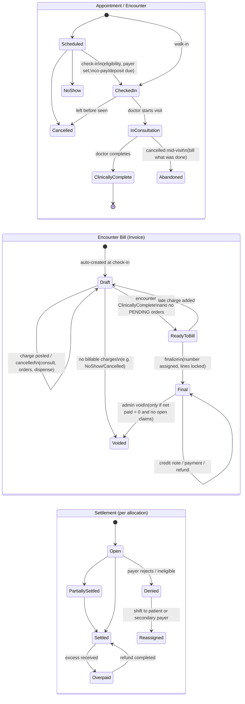

# Patient Journey and Billing Flow Audit

- **Date:** 2026-11-17
- **Scope:** check-in → consultation → orders/prescriptions → invoice → payment/claim
- **Method:** read-only review of the PRD (`backend/docs/PRD.md` §3.2, §6.1–6.3, §7.3–7.6, §9) and the code
  in `backend/app/{scheduling,clinical_records,billing,claims,patients}` and the
  reception, cashier, doctor and admin routes in `frontend/src/routes`.
- **Status:** findings and recommendations only. No code was changed as part of this audit.

> **Summary.** The payments core (cash, M-Pesa, SHA claims, voids, refunds,
> reconciliation) is reasonably built. But nothing turns clinical work into
> charges. Invoices are one-shot and are created already `ISSUED`. Several
> money-integrity races exist. The receptionist and cashier screens that should
> drive this flow are placeholders.

---

## 1. Current patient and billing flow

### 1.1 Step-by-step lifecycle

| # | Step | Actor | Code | State change |
|---|---|---|---|---|
| 1 | Register patient (optional SHA number and insurance stored) | Reception | `patients/service.py`; `PatientProfile.sha_number`, `insurance_provider`, `insurance_member_number` | none |
| 2a | Booked appointment | Patient, reception or online | `scheduling/service.py` `create_appointment` | Appointment `SCHEDULED` |
| 2b | Walk-in (registers the patient if new) | Reception | walk-in service in `scheduling/service.py` | Appointment `CHECKED_IN`, `arrived_at` set, no slot |
| 3 | Check-in | Reception | `scheduling/service.py` `transition()` | `SCHEDULED → CHECKED_IN` (`checked_in_at`, `arrived_at`) |
| 4 | Queue | system | `scheduling.service.queue()` | read-only |
| 5 | Start consultation (create visit) | Doctor | `clinical_records/service.py` `create_visit` | Appointment auto-moves to `IN_CONSULTATION`, even straight from `SCHEDULED` |
| 6 | Notes, vitals, diagnosis, plan; lab/scan **uploads**; referral | Doctor | `update_visit`, `create_attachment`, `create_referral` | none |
| 7 | Prescription | Doctor | `create_prescription` | `Prescription ISSUED`; drug, dose, quantity, **no price** |
| 8 | Complete visit | Doctor | `complete_visit` | `Visit.completed_at`, Appointment `COMPLETED`, emits `visit.completed` (**no consumer**) |
| 9 | Create invoice | Billing roles | `POST /visits/:id/invoices` → `billing/service.py` `create_invoice` | Invoice created **directly as `ISSUED`** |
| 10 | Payer split (optional) | Billing | `add_allocation` | `InvoiceAllocation PENDING` (PATIENT, SHA or INSURANCE) |
| 11a | Cash, card or bank | Billing | `record_payment` | Transaction `SUCCESS` → `recompute_invoice` |
| 11b | M-Pesa | Billing, then callback | `create_payment_intent`, `handle_mpesa_callback` | Intent `PENDING → SUCCESS`, `UNCONFIRMED` or `FAILED` |
| 11c | SHA | Billing | `claims/service.py` `run_eligibility_check`, `create_claim` | Claim `SUBMITTED`, SHA allocation created |
| 12 | Claim adjudication | Admin | `transition_claim` → `_settle_claim` | On `PAID`: SHA Transaction written, invoice recomputed |
| 13 | Corrections | Billing requests, admin decides | `decide_void`, `decide_refund` | Invoice `VOIDED`, Transaction `REVERSED`, Refund `COMPLETED` |
| 14 | End of day | Cashier | `cash_reconciliation`, `cash_expected_for` | `BALANCED` or `DISCREPANCY` |

### 1.2 Where charges and billing status change

1. **Charges are captured only once, at invoice creation** (`billing/service.py`
   `create_invoice`). There are two possible sources:
   - explicit `items` sent by the caller; or
   - default lines: the appointment's `Service` at `current_price` **plus** the
     doctor's `consultation_fee_minor` as a separate "Consultation" line.
2. **Discount** is a single `discount_minor` set at creation. It has no reason, no
   approval, and cannot be changed afterwards.
3. **Status is derived only in `recompute_invoice`**, which is called from cash
   payments, M-Pesa callbacks, transaction reversals, refunds, claim settlement
   and reconciliation resolution. The logic: `ISSUED`, then `PARTIALLY_PAID` or
   `PAID`, then `REFUNDED` once net paid ≤ 0 after refunds.
4. **Void** (`decide_void`) sets `VOIDED` and voids the allocations. It touches
   nothing else.
5. **Claim settlement** (`_settle_claim`) is the only path where the SHA portion
   turns into money.
6. **`InvoiceStatus.DRAFT` exists in the enum but is never used.**

Nothing between check-in and visit completion creates or changes a charge.

### 1.3 UI coverage today

| Screen | State |
|---|---|
| `receptionist/billing`, `receptionist/queue`, `cashier/invoices`, `cashier/payments`, `doctor/consultations` | **Placeholders** (about 16 lines each, no API calls) |
| `admin/billing` | Live. Takes payments on *existing* invoices, plus voids, refunds and reconciliation |
| `admin/claims` | Live. Claim status changes and resubmission only |
| `frontend/src/lib/api` | Has `runEligibilityCheck` and `createClaim`, but no screen calls them. **There is no `createInvoice` and no `addAllocation` client** |

In the shipped UI, nobody can create an invoice from a visit or start a SHA
claim. Both exist only through the API and seed data.

---

## 2. Comparison with real-world revenue cycle management

PRD §3.2 makes inpatient wards, pharmacy stock and laboratory information
systems **non-goals for v1**. The fair comparison is a Kenyan outpatient clinic
that bills SHA, private insurers, corporate accounts and self-pay. Practices that
apply only to inpatient care are marked as later-phase.

### 2.1 Eligibility and payer verification

| Real-world practice | MediFlow today | Gap |
|---|---|---|
| Verify coverage at **booking or check-in**, record the payer class on the encounter, collect the co-pay or deposit upfront | `EligibilityCheck` is tied to an **invoice**, so it can only run after the visit is invoiced | High. The patient learns about non-coverage at checkout |
| Pre-authorization for procedures above a threshold | None | Medium (procedures are not modelled) |
| Primary and secondary payers, plus corporate accounts | Profile stores insurer fields. The `INSURANCE` payer enum has **no flow** (no eligibility, no claim). No corporate account concept | High for clinics with private insurers |
| SHA inactive or limit exhausted: convert to self-pay (**BIL-8**) | `create_claim` raises `409 not eligible`. No conversion, no prompt | **P0 PRD gap** |

### 2.2 Charge capture

| Real-world practice | MediFlow today |
|---|---|
| Clinical actions post charges to an open encounter ledger as they happen: consultation on start, labs and imaging on order, procedures on performance, drugs on dispense | **No charge capture.** Labs and imaging are file uploads only (no order entity). Prescriptions have no price or catalogue link. `visit.completed` has no billing consumer |
| Charge description master (priced catalogue with codes) | Partly there: `Service` + `ServicePrice` with effective dates. Invoice lines snapshot the unit price |
| Charge reconciliation: catch missed charges before claim submission | Not possible; there is nothing to reconcile against |
| No duplicate charges | **Likely double charge:** the default lines add the appointment's service (for example "General consultation", `CONS-GEN`) **and** a separate doctor "Consultation" fee. The seed data has exactly this combination |

### 2.3 Split billing and payer mix

| Real-world practice | MediFlow today |
|---|---|
| Per-line payer responsibility (contract rates, exclusions, co-pay or co-insurance); the patient share is computed | Split at **invoice level only** (`InvoiceAllocation`: payer + amount). No co-pay rules |
| Underpayment or denial shifts the balance to the patient or the secondary payer | If SHA approves less than claimed, the shortfall **silently stays** on the invoice. The SHA allocation is marked `PAID` anyway, and no PATIENT allocation is created. A rejected claim leaves the SHA allocation `PENDING` forever |
| The payer split always sums to the total | `add_allocation` only checks `≤ total`; the patient share is implicit |
| Each payment is linked to the payer bucket it settles | `Transaction.allocation_id` is set only by SHA settlement. Cash and M-Pesa never link to a PATIENT allocation, so outstanding co-pay can't be reported |

### 2.4 Mid-visit adjustments and cancellations

| Real-world practice | MediFlow today |
|---|---|
| Cancelling an unperformed order removes its charge; drug returns credit the line | No orders. Lines are **immutable once issued**, and there's no endpoint to add or remove a line. The only correction is an admin void of the whole invoice, then recreating it |
| Discounts and waivers with reason codes, approval thresholds and audit | One untyped `discount_minor` at creation; no reason, approver or audit detail |
| Visit cancelled after partial care: bill what was done | Appointment allows `IN_CONSULTATION → CANCELLED`, but the visit stays open and any invoice is unaffected |
| Documentation is restricted after billing | `update_visit` has no completion or invoice guard, so diagnosis can change after a claim is submitted |

### 2.5 Draft vs finalized invoices

| Real-world practice | MediFlow today |
|---|---|
| An open encounter bill (interim statement or superbill) accumulates charges. The final invoice is generated at checkout, then **locked**. Corrections happen through credit notes or rebills | No encounter bill. The invoice is born `ISSUED`; `DRAFT` is unused |
| You can't finalize while the visit is open or orders are pending | Invoicing is allowed before `visit.completed_at` is set, and the visit stays editable |
| Credit notes for partial corrections | Only a full void, or a refund against a transaction. A refund on a paid invoice flips it to `PARTIALLY_PAID`, which looks like the patient still owes money |

### 2.6 PRD requirement status (billing)

| Requirement | Status |
|---|---|
| BIL-1, 2, 3, 4, 6, 10, 13, 14 | Largely met in the backend; the reception and cashier UI is missing |
| BIL-5 | Met mechanically, but at billing time instead of check-in |
| BIL-7 | Partial: invoice-level split, no shortfall handling |
| **BIL-8** | **Not met** |
| BIL-15 (Paybill or Till capture) | Not present: only STK push exists, with no C2B confirmation endpoint |

---

## 3. Gaps, edge cases and recommendations

### 3.1 Integrity bugs and race conditions (verified in code)

1. **Overpayment races.** `record_payment` reads `balance_minor` and inserts a
   transaction without locking the invoice row. There is no `with_for_update` anywhere in billing. Two
   cashiers, or cash plus a pending M-Pesa intent, can both pass the check. The result is a
   negative balance with status `PAID`.
2. **M-Pesa callback trusts the reported amount.** It is not compared with the intent amount
   or the outstanding balance.
3. **Payments after void.** A callback arriving after a void still writes a `SUCCESS`
   transaction. `recompute_invoice` returns early for `VOIDED`, so the money is
   invisible and never flagged for refund.
4. **Voiding a paid or claimed invoice** neither requires refunds or reversals nor
   cancels open claims. A SHA claim can later settle into a voided invoice.
5. **Claim amount is validated against the total, not the balance**
   (`claims/service.py`). After a partial cash payment, a full claim causes overpayment.
6. **Cash payments aren't idempotent.** Payment intents honour
   `Idempotency-Key`; `POST /invoices/:id/transactions` doesn't.
7. **Cash day boundary uses UTC.** `cash_expected_for` and `cash_summary` use UTC
   midnight, so Nairobi cash taken between 00:00 and 03:00 lands on the previous day.
8. **Encounter shortcuts.** Creating a visit from `SCHEDULED` silently checks the
   patient in, skipping reception and any eligibility check. Cancelling an
   in-consultation appointment leaves the visit open.

### 3.2 UX friction

- **Reception and cashier:** no screen to invoice a completed visit, choose a
  payer mix, verify SHA, or convert to self-pay.
- **Doctor:** no orders panel. Prescriptions show no cost.
- **Queue and check-in:** no payer badge (SHA active, insurer, cash) and no
  co-pay or deposit due.
- **Cashier:** no "ready to bill" work-list of completed visits without an invoice.

### 3.3 Recommendations

#### Quick wins (small; mostly backend; no new core entities)

| # | Change | Addresses |
|---|---|---|
| Q1 | Lock the invoice row (`SELECT … FOR UPDATE`) in `record_payment`, `handle_mpesa_callback`, `_settle_claim`, `decide_void`. Reject over-balance payments. In the callback, compare against the intent amount and route mismatches to `UNCONFIRMED` | 3.1 #1–2 |
| Q2 | Money received against a `VOIDED` invoice goes to the reconciliation queue as `UNCONFIRMED` (refund required) | 3.1 #3 |
| Q3 | `decide_void` refuses while net payments or open claims exist (or cascades claim `CANCELLED`) | 3.1 #4 |
| Q4 | `create_claim`: amount ≤ outstanding balance minus other pending allocations | 3.1 #5 |
| Q5 | `Idempotency-Key` support on `POST /invoices/:id/transactions` | 3.1 #6 |
| Q6 | Hospital-timezone day bounds for cash summary and reconciliation (reuse `app/common/time.py`) | 3.1 #7 |
| Q7 | One source of truth for the consultation charge (service price *or* doctor fee, not both) | 2.2 double charge |
| Q8 | `create_invoice` requires a completed visit; `update_visit` is blocked or audited after completion | 2.4, 2.5 |
| Q9 | BIL-8: when the result is not `ACTIVE`, void the SHA allocation, create a PATIENT allocation, and return `next_action: choose_payment_method` | **P0 gap** |
| Q10 | Claim `REJECTED` voids the SHA allocation. Partial `PAID` creates a PATIENT allocation for the shortfall and notifies billing | 2.3 |
| Q11 | Discounts require a reason, are audited, and need admin approval above a configurable threshold | 2.4 |
| Q12 | Frontend: `createInvoice` and `addAllocation` clients; wire `receptionist/billing` (invoice from visit, payer choice, SHA verification, self-pay fallback) | 1.3 |

#### Structural improvements

| # | Change | Notes |
|---|---|---|
| S1 | **Encounter bill:** the `DRAFT` invoice is auto-created at check-in or walk-in and accumulates lines. **Finalize** assigns the number, sets the final status, and locks the lines | Invoice numbers are consumed only on finalize |
| S2 | **Charge capture:** `ChargeItem` (encounter, service, qty, unit price snapshot, source, status `PENDING/POSTED/CANCELLED`). Sources: consultation start, an `Order` entity for lab and imaging (ordered → performed → resulted), and prescription items linked to priced drug services (charged at dispense, credited on return) | Billable orders only; no LIS or stock system (within v1 non-goals) |
| S3 | **Coverage model:** `PatientCoverage` (SHA, insurer, corporate; member number; priority; validity) and `PayerPlan` (co-pay flat or percent, exclusions). Per-line payer responsibility | Activates the `INSURANCE` payer |
| S4 | **Eligibility at check-in**, keyed to the encounter (`invoice_id` nullable). The check-in UI shows the payer badge and co-pay due. Claims reuse a fresh check | Moves BIL-5 to the right point |
| S5 | **Credit notes** for partial corrections (lines, amount, reason, approver). Void is reserved for "issued in error" | BIL-10 friendly |
| S6 | Separate lifecycle status (`DRAFT/FINAL/VOIDED`) from a derived payment status (`UNPAID/PARTIAL/PAID/OVERPAID/REFUNDED`) | Removes the misleading refund state |
| S7 | Balances computed from immutable postings (charges, credits, payments, refunds) | Removes recompute drift |
| S8 | Work-lists: Ready to bill, Awaiting payer, Unapplied money | Cashier and admin UI |
| Later | Inpatient: deposits, daily interim bills, bed and ward charges, discharge-gated finalization | Builds on S1, S2, S5 |

**Suggested order:** Q1–Q6 (money integrity) → Q7–Q10 (correct amounts, BIL-8)
→ Q12 (usable UI) → S1 + S4 → S2 → S3 → S5–S8.

---

## 4. Proposed visit ↔ billing state machine

### Interaction rules

| Encounter event | Billing effect |
|---|---|
| Check-in or walk-in | Create the `Draft` bill; run eligibility; create allocations (SHA, insurer, patient); show co-pay due |
| Doctor starts the visit | Post the consultation charge (once, idempotent) |
| Order placed, performed or cancelled | Charge `PENDING`, then `POSTED`, or cancelled |
| Prescription dispensed or returned | Post the charge or a credit |
| Clinically complete | `ReadyToBill` if no `PENDING` orders; otherwise stay `Draft` with a warning |
| No-show or cancelled before care | Void the `Draft` (or apply a configured no-show fee) |
| Abandoned mid-visit | Bill posted charges only |
| Finalize | Lock lines; submit the SHA claim for the SHA allocation; collect the patient allocation |
| Claim `REJECTED` or partial `PAID` | Allocation goes to `Denied`, then `Reassigned` to the patient (BIL-8) |
| Clinical edits after `Final` | Allowed, but they don't change charges; charge corrections use credit notes |

The overall bill status is derived: `Final` with every allocation `Settled` means
**Paid**. Any `Overpaid` allocation flags the invoice for refund.
